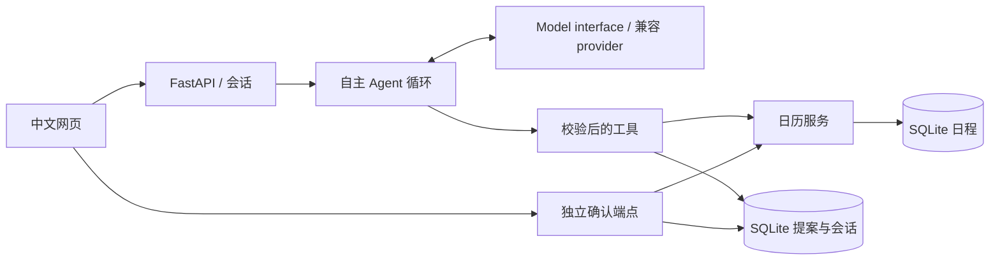

# 设计说明

> 当前回收站轮：141通过、2个live默认跳过、覆盖率92%；真实DeepSeek12请求/$0.014142437，含参数失败记录。详情见[本轮验收](docs/TRASH_TEST_2026-10-17.md)。
## 目标与范围

以 `test.md` 的原题为依据：中文自然语言网页、必须调用 LLM、偏好真正自主工具推理、配置示例、完整代码、现场演示与关键设计理由。原题中的 CRUD 是可选设计方向，本次根据补充请求选择把 CRUD 全流程完成；额外要求是 SQLite 持久化、自动化测试、安全确认和完整文档。

本地实现提供独立真实provider接口，本轮使用DeepSeek完成少量真实多轮和工具评估；离线与真实模型证据分开记录，不将小样本通过等同自然语言准确率或全部供应商兼容性保证。

## 1. 整体架构

模型负责理解、日期解释、检索策略、比较候选、决定是否再调用工具和要澄清什么。代码负责类型/时区/冲突/事务/版本/幂等/授权，双方职责互补。

## 2. Agent 推理设计

`agent.py` 的 System Prompt 每轮注入当前带时区时间、工具边界、真实结果约束、最大步数和用户选中的候选。模型接收完整工具 schema，可自主决定搜索、寻找空档、追问或提案，没有固定“意图分类→实体提取→固定 CRUD”路由。

每次工具返回结构化 observation，再给模型下一次推理。例如创建冲突时返回冲突日程和可用时间，模型可以进一步 `find_slots`、换范围、询问用户；修改时可先粗搜索，看到多候选后缩小搜索或提问。`ask_user`/有效提案会结束本轮，等待真实用户输入。

不展示或存储内部思维链；可见摘要只列工具名称与结果状态。8轮模型调用、每批最多8工具、单次30秒/整轮90秒限制控制失控循环。工具参数错误返回 observation，模型有机会修复。HTTP 本身不自动重试。

## 3. 多轮与澄清

SQLite 持久化最近12个完整轮次（含工具调用和 observation），上下文截断以完整轮次为单位，不产生孤立 tool 消息。后续“下午3点，一小时”等补充由 LLM 联系前文解释。

模型通过 `ask_user(fields=[...])` 选择缺少标题、日期、开始、时长、目标选择、冲突替代或范围说明。中文问题由这些字段和真实工具结果生成；这限制自由措辞，却能阻止模型在“澄清文本”中夹带未执行的成功声明。该层只约束输出事实，不代替模型的理解和工具决策。

## 4. 目标匹配策略

`search_events` 将模型的 query 与日期范围用于结构化检索：标题/地点/备注子串 + 标题字符相似度窗口召回；按时间、ID稳定排序。短中文词允许错字，代价是更多候选，适合小规模本地日程；无需 embedding 账号和向量库。

工具返回真实 ID/版本与所有候选，模型据此选择下一步。没有候选时请重述或换关键词。多候选时禁止直接提案，必须缩小检索为唯一目标，或让用户点选明确候选；点选只在一个模型回合内有效，该回合内再次检索保留同ID/版本选择；用户最终还要确认具体记录。未检索 ID 不允许修改/删除，过期版本拒绝操作。

## 5. 冲突处理

统一以 UTC 秒保存半开区间 `[start,end)`；相邻结束/开始无冲突。创建和修改发生不兼容重叠时建立冲突上下文，显示逐对重叠、2–4个经过最终状态验证的方案（硬约束可能减少数量），或澄清。选择稳定ID后生成统一提案，不能暗自改动日程。明确核实的可暂停/并行活动允许嵌套；跨地点需显式配对授权和往返/注意力条件。

原题“明天下午3点 A，次日说今天下午3点 B”的情况会归一到同一 UTC 区间，日期推进不会绕过冲突。检测由代码负责可靠性，如何询问、是否扩大范围等交给模型。确认时在写事务中重新检测，防止提案后出现新冲突。

## 6. 写入与确认

所有新建/修改/删除都产生15分钟有效的服务器提案，记录原值、目标 ID 和版本。模型无执行写入的工具，也不能自己批准提案；网页展示前后值、具体日期地点，用户通过独立端点确认。

确认以 `BEGIN IMMEDIATE` 原子完成（写入包含保存点，核验失败回滚写入并保留失败回执）：验证提案所属会话/有效性→检查目标版本与冲突→写入→读回核对或确认已删除→记录回执。重复确认返回相同回执；新消息替代旧提案；异常不报告成功。单项歧义不得猜测；明确范围全部取消使用独立批量清单，一次确认后软删除。

## 7. 查询与输出

模型选择查询条件、检索范围和是否重新搜索；代码返回真实结构化记录。最终查询、空档和操作回执由工具结果生成自然语言，丢弃无证据的 assistant.content，因此模型声称“已删除”不会变成事实回复。代价是最终回复较模板化，换来可验证的一致性。

## 8. 交互模式与持久化

中文多轮网页，原生 HTML/CSS/JS，无前端工具链。左侧对话、澄清和确认卡，右侧日程列表与日期过滤。随机 HttpOnly/SameSite cookie 管理会话；本地日历是单用户共享，不宣称多租户隔离。

SQLite 是嵌入式真实存储。事件、会话、提案、请求回执重启后保留；无外部日历 OAuth 和邀请副作用。演示替身只替换模型边界，实际工具、HTTP、事务、数据库不替换。

## 9. 配置、失败恢复与取舍

JSON 示例包含 endpoint/model/api_key，支持 `.env` 和系统环境覆盖。provider 使用独立 Model Protocol，支持 Chat Completions tools；不支持的服务明确报错。模型异常不包含原始响应，避免暴露密钥；会话错误可再次输入重试，不假装理解成功。

缺省不猜时长、不支持周期/邀请/跨账号同步；不提供语音、向量检索、Redis 或多 Agent。所有写入需点击确认，增加一个动作但让面试演示和安全操作可解释。没有真实模型配置时只运行离线验收，不将 fixture 输出作为模型质量证据。

技术选择与上游调研详见 [RESEARCH.md](docs/RESEARCH.md)，详细接口见 [ARCHITECTURE.md](docs/ARCHITECTURE.md)，验收映射见 [REQUIREMENTS.md](docs/REQUIREMENTS.md)。

## 当前多事件编排与呈现

自然语言提取仍由模型完成，stage_task是严格的结构化草稿工具，不是规则意图分类器。部分事件、事件关系和revision持久保存，澄清不重启；显式配对授权支持已核实往返的暂停外出而不伪造相同地点。写入统一提案、终态重验和原子执行保留。冲突默认短事实＋推荐，其余折叠；详情与确认仍提供前后对照。真实/模拟证据分开见本轮验收。

## 当前批量取消和恢复设计

单项候选门控保持；明确“某范围全部”用结构化范围工具查询完整实际集合，支持唯一引用/checkbox排除，统一确认。date/today/tomorrow/week/afternoon/interval来自模型，确定性代码计算半开边界。普通搜索不会看到软删除，回收站显式观察仍回送模型以继续恢复工具。scope是object，字符串严格拒绝并给正确对象示例。

确认复用事务及保存点，操作前后均全量校验。ID保留、删除/恢复version递增，7天期限与来源批次绑定。即时undo是用户按钮明确授权的原操作恢复，LLM仍只能提出恢复；冲突时另选子集。无自动后台清理或外部同步。
