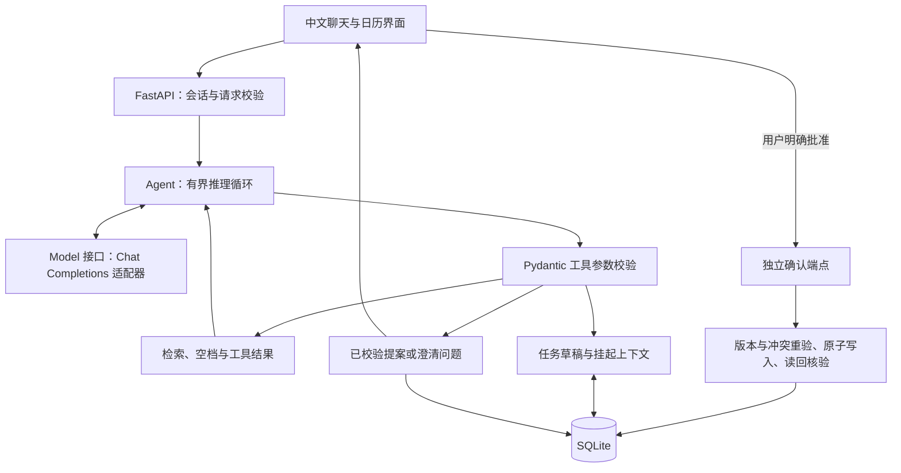
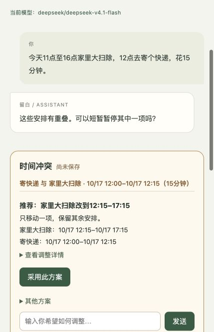
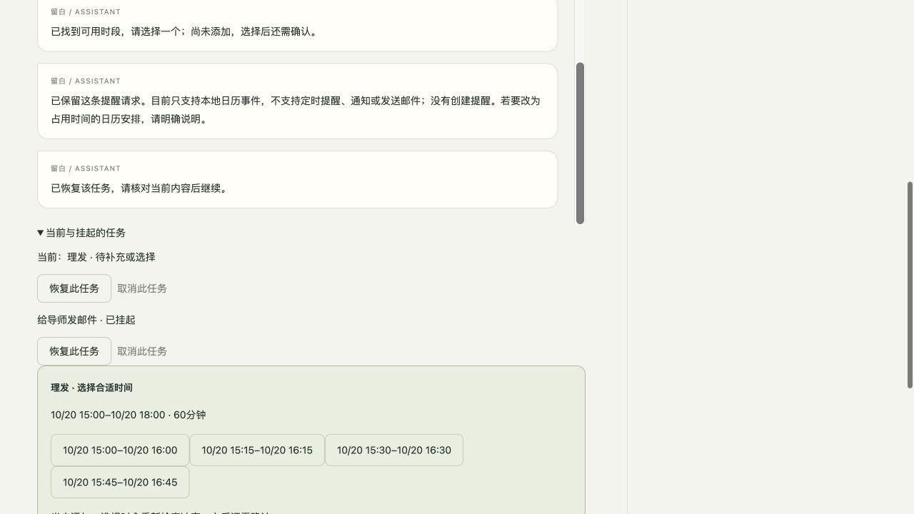

# 留白 · 中文日程 Agent

一个本地运行的日程助手：通过原生 LLM 工具调用理解中文安排，以独立任务上下文保留多轮信息，让用户确认具体变更后，再通过 SQLite 事务写入日历。

面对多事件、缺失时间和冲突约束，留白保留草稿并针对缺项追问，避免遗漏安排或未经确认写入。

**验证摘要 · 2026-10-17：** 离线测试 **183 passed、2 live tests skipped，覆盖率92%**。独立真实模型复验已验证工具调用与任务切换；本轮完整的“最终提案→确认写入”链路尚未验收。[查看验证范围 ↓](#测试与验证)

## 核心功能与技术栈

- **中文对话式日程 CRUD：** 创建、查询、修改、取消；支持标题相似度匹配及标题、地点、备注检索，多候选时要求明确选择。
- **多事件规划：** 保留部分草稿、共享时间范围及事件关系；缺少时间分配时追问，不猜测时长、自动均分或假定并行。
- **独立任务上下文：** 支持挂起、恢复和取消未完成任务，避免新请求混入旧草稿；下午灵活安排提供真实空档供用户选择。
- **冲突方案与确认：** 展示具体重叠、经过校验的替代方案，并在方案选择和最终确认时重新检查约束。
- **批量操作与恢复：** 批量取消、保留7天的回收站，以及显式撤销和恢复。

**技术栈：** Python 3.12+、FastAPI、Pydantic、HTTPX、SQLite、原生 HTML/CSS/JavaScript。测试使用 pytest、pytest-cov、Ruff 和 Node.js；无需前端构建或外部日历服务。

## 技术架构



| 关键组件 | 职责 |
|---|---|
| [`agent.py`](scheduler/agent.py)、[`provider.py`](scheduler/provider.py) | 原生模型→工具→结果循环；可替换模型接口、协议校验与执行上限。 |
| [`tools.py`](scheduler/tools.py)、[`flow.py`](scheduler/flow.py) | 严格工具参数、目标选择门控、任务边界与空档候选。 |
| [`tasks.py`](scheduler/tasks.py)、[`conflicts.py`](scheduler/conflicts.py) | 增量事件草稿、共享范围、关系约束与可行冲突方案。 |
| [`calendar.py`](scheduler/calendar.py)、[`storage.py`](scheduler/storage.py)、[`trash.py`](scheduler/trash.py) | 时间归一、检索、冲突检查、提案、事务、持久化与恢复。 |
| [`app.py`](scheduler/app.py)、[`static/`](scheduler/static/) | 本地 HTTP API、会话与安全校验、确认界面，以及迟到响应防护。 |

## 关键工程设计

**原生 Tool Calling。** 模型理解意图、解释日期并选择工具，程序校验参数并返回真实结果；不是硬编码意图分类器。可通过配置切换兼容模型。默认最多8次调用/轮，HTTP 超时30秒、整轮90秒，不自动重试。

**任务上下文隔离。** 未完成任务保存独立快照，模型显式选择新建、继续、恢复、取消或澄清。新消息暂停旧确认，仅显式恢复可重新使用有效提案；共享范围保持组级约束，不复制成每项时段。

**用户确认机制。** 工具只能准备提案，模型没有批准写入的工具。界面展示精确变更，用户确认后才执行；模型自由文本不能当作成功回执。一键撤销本身是用户明确授权的恢复动作。

**冲突与约束校验。** 时间以 UTC 半开区间保存，按 IANA 时区显示。方案检查事件版本和硬约束，确认时再次校验。重叠安排需要显式核实共存条件，不提供强制覆盖入口。

**事务与持久化。** SQLite 保存日程、对话、任务、提案和回执。`BEGIN IMMEDIATE` 与保存点保障批量原子执行，核验失败回滚；版本和幂等回执防止旧数据更新与重复确认，成功后读回核验。

详细说明：[设计理由](DESIGN.md) · [技术架构](docs/ARCHITECTURE.md)。

## 产品界面与演示

以下中文界面截图使用合成日程，来自历史验收，不代表最新真实模型完整流程。

**精简冲突面板：** 展示重叠事实、替代时间和方案选择入口；选择后先生成提案，仍需确认。截图来自历史真实模型与浏览器检查（[报告](docs/UX_TEST_2026-10-17.md)）。



<details>
<summary>查看任务切换与空档选择截图</summary>

旧邮件请求挂起，理发任务提供空档。截图来自**脚本模型浏览器验收**，不是真实模型端到端测试（[报告](docs/CONTEXT_ISOLATION_2026-10-17.md)）。



</details>

## 快速启动

需要 **Python 3.12+**、Git 和 POSIX shell，以下命令适用于 macOS/Linux。运行应用无需 Node.js；完整测试另需 Node.js。

```bash
git clone https://github.com/jsuii/schedule-agent.git
cd schedule-agent
python3.12 -m venv .venv
source .venv/bin/activate
python -m pip install -e '.[dev]' -c requirements.lock
```

依赖版本已固定，静态资源随包提供，无需 npm 安装。

### 无 API key 的离线演示

```bash
python -m scheduler.demo --database data/portfolio-demo-01.sqlite3 --port 8001
```

打开 [localhost:8001](http://127.0.0.1:8001)，点击 **演示下一步**，依次体验：澄清→创建并确认→查询→修改→冲突处理→同名目标消歧与取消。工具、HTTP、用户确认和 SQLite 均为真实实现；**模型是确定性 replay 替身，不理解任意输入**。

重复完整演示请换一个新的数据库文件名。“新对话”只重置对话上下文，不清空日历。更多场景见[演示指南](DEMO.md)。

### 配置真实模型

复制模板，保留已有的本地配置：

```bash
cp -n .env.example .env
```

在本地编辑 `.env`。以下为最新记录的真实模型复验所用配置示例：

```dotenv
LLM_ENDPOINT=https://openrouter.ai/api/v1
LLM_MODEL=deepseek/deepseek-v4.1-flash
LLM_API_KEY=replace-with-your-own-key
APP_TIMEZONE=Asia/Shanghai
APP_DATABASE=data/calendar.sqlite3
```

模板中的通用占位符需要替换为自己的服务配置。模型可访问性取决于账户和地区；请勿将 `.env` 或密钥提交到 Git。

```bash
python -m scheduler
```

打开 [localhost:8000](http://127.0.0.1:8000)。首次启动自动创建数据库并迁移 schema。自定义端口：

```bash
python -m uvicorn scheduler.app:create_app --factory --host 127.0.0.1 --port 8002
```

配置优先级：**进程环境变量 > `.env` > 可选 JSON > 默认值**。JSON 方式见 [`config.example.json`](config.example.json)，本地复制为 `config.local.json` 并设置 `APP_CONFIG=config.local.json`。修改后重启；界面和 `/api/health` 显示已加载的模型 ID，不保证连通。

模型端点需支持非流式 OpenAI 兼容 Chat Completions、原生工具调用、JSON Schema（含 `$defs`/`$ref`）及 `role: tool`/`tool_call_id` 多轮回传；base URL 自动补充 `/chat/completions`。远程要求 HTTPS，不兼容时明确报错。401/403检查认证权限，400/404检查协议、端点和模型。详见[架构说明](docs/ARCHITECTURE.md)。

## 测试与验证

最新记录基线：**2026-10-17**。覆盖率衡量代码执行范围，不代表自然语言理解准确率。

| 验证类型 | 实际结果 | 覆盖范围与边界 |
|---|---|---|
| 离线自动化测试 | **183 passed、2 live tests skipped，覆盖率92%**；Ruff lint/format 与 JS 语法检查通过。 | 模型边界使用脚本替身和 HTTP mock；SQLite、HTTP 集成、确认、冲突、持久化、回滚及 JS 请求生命周期均执行真实实现。 |
| Replay 演示 | 固定“演示下一步”流程及脚本模型浏览器检查。 | 验证应用流程，不评估 LLM 的语言理解能力。 |
| 最新真实模型 smoke test | **9次 HTTP 200、55,532 reported tokens、API 报告费用 US$0.0044401388**；通过 OpenRouter 使用 DeepSeek。10次尝试中包含1次连接失败。 | 已验证基础推理、原生工具调用→结果回传→最终回答、共享时间澄清、独立任务切换和原任务快照恢复。仅用合成数据库，没有写入日历。 |
| 完整真实模型端到端流程 | **最新一轮尚未完成**；两个既有 live pytest 未重跑。 | 时间分配澄清后的最终提案、用户确认与持久化写入、浏览器真实模型端到端流程，本轮均未验收；请求额度用完后停止调用。 |

在已激活的环境运行完整**离线**门禁（需要 Node.js）：

```bash
RUN_LIVE_LLM=0 sh scripts/check.sh
```

门禁包含 pytest/覆盖率、Ruff lint/format 和 JS 语法检查。两项真实模型测试须主动开启，会发送合成数据并产生费用：

```bash
# 可选付费评估，不属于离线门禁。
RUN_LIVE_LLM=1 python -m pytest -m live -v
```

[最新真实复验证据](docs/PRE_SUBMIT_LIVE_2026-10-17.md) · [测试范围与历史结果](docs/TESTING.md) · [提交前检查](docs/PRE_SUBMIT_REVIEW_2026-10-17.md)。凭据、原始评估日志和数据库不纳入 Git。历史成功结果保留为历史证据，不计入最新一轮通过项。

## 已知限制与未来方向

- **本地、单用户、单进程。** 会话隔离的是对话和提案，不是日历数据归属。仅绑定 loopback；托管服务仍需认证和跨进程协调。
- **模型语义判断可能出错。** 缺失时长、时间分配歧义、未核实的重叠条件仍需澄清；不猜测优先级、不自动均分共享范围，不保证任意中文输入都能正确理解。
- **没有通知或外部同步。** 提醒请求可保留并准确说明能力限制，但尚未实现定时通知、邮件、邀请、周期事件或 Google Calendar 集成。
- **状态与检索有界。** 提案和草稿15分钟有效，模型历史保留12个完整轮次。模糊检索基于字符相似度而非 embedding；空档搜索按15分钟步进，灵活安排目前限定12:00–18:00。没有节假日/工作日规则或长期会话自动清理。
- **外部模型的数据边界。** 配置模型后，相关对话和检索到的日程会发送给该服务。请使用可信端点和适当测试数据；replay 演示不调用真实模型。

未来方向：有预算约束的完整“提案→写入”真实模型评估、更强检索、数据保留策略和带认证部署；均非已实现功能。

## 延伸阅读

[需求追踪](docs/REQUIREMENTS.md) · [产品设计](docs/PRODUCT_DESIGN.md) · [设计说明](DESIGN.md) · [技术架构](docs/ARCHITECTURE.md) · [演示指南](DEMO.md) · [迭代日志](AUTONOMOUS_WORK_LOG.md)

历史回归与修复报告保留在 [`docs/`](docs/) 中。项目采用 [MIT 许可证](LICENSE)。
