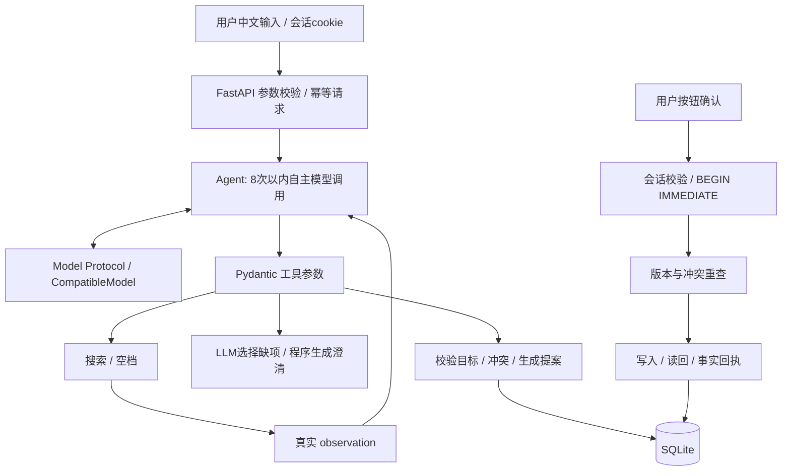

# 技术架构

> 当前冲突轮验证：96通过、2个live默认跳过，覆盖率94%；真实DeepSeek共25次（包含失败）、$0.0218568444。详情见[冲突验收](CONFLICT_TEST_2026-10-17.md)。
## 技术选择

Python 3.12、FastAPI、Pydantic、HTTPX、SQLite、原生 HTML/CSS/JS。一个进程即可启动，静态资源随 wheel 包分发。仓库/AgentScope/Dify 的实际源码与适配比较见 [RESEARCH.md](RESEARCH.md)。没有复制第三方项目的实现代码，也没有将原始任务文档中的外部发布要求当作当前推送授权。

## 组件职责与接口

| 组件 | 职责 / 接口 |
|---|---|
| config.py | Settings.load：JSON、.env、系统环境；SecretStr；时区与endpoint校验 |
| provider.py | Model.complete(messages, tools) → assistant message；CompatibleModel仅管理HTTP和协议，不碰数据库 |
| agent.py | Agent.run(sid,text)：构造当前时间/历史、循环、接收工具结果、停止与错误恢复 |
| tools.py | SCHEMAS 与 Tools.execute(name,args)：参数校验、候选授权门控、澄清/提案 |
| calendar.py | validate/search/conflicts/slots/create/update/delete；真实事务CRUD及读回 |
| storage.py | Store：会话、轮次、候选、提案确认、请求幂等 |
| app.py | 本地HTTP、cookie、Origin/Host、安全响应头、会话并发锁 |
| demo.py | 显式 ReplayModel 替身；只在独立入口注入，不影响正常 provider |

模型可替换为任意实现同一异步 Protocol 的适配器，日历服务无需知道模型来自哪个厂商。工具只能提案，确认不是 LLM 工具。业务逻辑没有意图分类枚举、正则解析中文请求或测试专用CRUD分支。

## 工具输入输出

以下参数最终以 Pydantic 生成的 JSON Schema 为准，详见 tools.py。所有 schema 禁止额外字段。

| 工具 | 输入 | 输出 / 终止行为 |
|---|---|---|
| search_events | query?，ISO start?，end? | events（最多50条）、truncated；更新本会话候选/观测版本 |
| find_slots | start，end，duration_minutes（5–1440），exclude_id? | slots（最多5个）；最多31天范围，15分钟步进 |
| ask_user | fields 数组：title/date/start/duration/selection/alternative/scope/details | 从缺项与真实工具结果生成 question；缺空档证据时返回missing_observation继续模型循环，有证据才结束本轮 |
| propose_create | title，start，end，location?，notes? | proposal 或 conflict/invalid_*；成功即结束本轮 |
| propose_update | event_id，patch | 校验已观测目标/多候选/版本；proposal；成功结束 |
| propose_delete | event_id | 同上，proposal；无删除执行权限 |

事件结构：`{id,title,start,end,location,notes,version}`；传输时间均为带偏移 ISO。Patch至少一个非null字段，额外字段禁止；移动start但未给end时保留原时长。搜索是半开时间区间相交，不只检查开始日在范围内。

工具错误结构：`{error, hint?, events?, alternatives?}`。代码校验失败、冲突或歧义回送模型，模型可以修正、搜索或追问；不会由固定意图路由强制走同一路径。

## 执行与事实边界

1. 刷新当前带时区时间，载入12个完整轮次和候选选择。
2. 向模型发送system、conversation及tools，接受原生工具调用。
3. 校验JSON arguments与schema，执行合法工具，所有结果回送为role=tool。
4. 继续调用模型；ask_user或提案结束等待真实用户；纯查询结束生成事实列表。
5. 普通assistant.content不能当操作回执。澄清只接受枚举缺项，防止自由文本绕过事实检查。
6. 用户经HTTP确认，事务提交与读回。结果和聊天回执一起持久化。

不生成自然语言结果再让模型“自证成功”。最终事件数据来自查询/读回，删除通过重新get不存在验证。LLM仍负责理解日期、匹配策略、下一步工具选择和澄清内容类别，而不是简单的文本分类器。

## 数据持久化与一致性

SQLite schema版本1，首次启动自动创建：

- events：uuid主键、文本字段、UTC整秒起止、递增version，起止索引。
- sessions：不可预测随机会话id，完整turns JSON，观测候选及selected_id。
- proposals：随机id、所属session、action、完整目标payload、before快照、id/version、有效期、状态与最终回执。
- requests：session+request_id唯一，缓存最终响应；中断的未完成请求返回busy，不重复执行。

WAL与10秒数据库锁超时。确认事务使用BEGIN IMMEDIATE，将冲突检查、目标版本、写入、读回、回执与提案状态放进同一事务；日历写入另有SAVEPOINT，核验失败回滚该写入但持久化失败回执；并发重复确认只会执行一次。失败未提交时回滚；冲突/旧版本在写入前拒绝。确认完成清除旧候选，后续修改重新检索。候选保存原查询及版本，提案前重查同一截断窗口；新增/变化要求重新检索。用户卡片选择只在下一工具回合有效，不跨任务泄漏。普通新消息使旧pending提案失效。

每会话asyncio锁避免同一进程中并发改会话；不同会话可并行等待模型。此锁不跨进程，因此只支持单worker。本地日历共用，cookie不是多用户日历访问控制；不得将本应用当公网上的多租户服务。

## 日期、时间和检索

默认Asia/Shanghai，配置可换IANA时区。模型负责“明天”“下周”等语义，程序每轮提供真实当前时间，并将ISO转为UTC整秒存储；显示转回配置时区。时间必须含具体时刻，1970–2100，结束晚于开始且最长7天。

无offset本地时间用配置时区解释；DST gap/fold都拒绝并要求显式偏移。显式offset可以表达秋季重复小时。区间 `[start,end)` 相邻不冲突；跨午夜按真实秒数计算。Slots在UTC时间轴步进，避免DST重复计时。

模糊检索采用子串和标题等宽窗口SequenceMatcher；2字词阈值0.5，更长0.6，单字只做子串。仅负责扩大候选，不能作为写入授权。查询按开始、id排序；不声称向量语义召回。当前SQLite先取日期过滤结果再Python匹配，适合小数据集。

## Provider兼容、异常和限制

配置完整Chat Completions地址或以/v1结束base；统一追加/chat/completions。发送tools、tool_choice:auto、stream:false；校验assistant角色、tool_calls结构、重复id、每批8次上限、参数字符串长度。每次HTTP默认30秒，全轮90秒、最多8轮。工具参数错误可在剩余轮内修复，没有无限重试。

不强加strict structured-output扩展，不伪造不支持tools的文本fallback；兼容性失败应更换模型或编写新provider。HTTP失败不自动重试，输出分类错误，不回传原始body或异常字符串。真实模型验收入口test_live.py默认跳过，后续单独开启。

## 安全与隐私

state/health只公开运行模型ID，不公开端点/密钥。模型API key只从配置进入Authorization头；SecretStr隐藏repr；HTTP不跟随重定向。remote只允许HTTPS，loopback允许HTTP。前端不接收endpoint/key配置值；模型原始body不写日志。日程内容经textContent渲染，SQL参数化。

随机HttpOnly、SameSite=Strict cookie；确认绑定session和服务器提案，不能由模型传confirmed=true绕过。POST要求JSON，检查Origin与Sec-Fetch-Site，TrustedHost限制本地Host，CSP/X-Content-Type-Options和no-store防内容执行/缓存。不是OS级隔离或多用户认证。

System Prompt把日程标题备注视为数据；即使模型被内容诱导，最多提出待用户核对的提案，无法授权提交。检索后发送给已配置模型的事件是外部数据传输，配置前应理解数据边界。默认无真实模型联网和真实外部日历账号操作。

## 测试与未来改进

真实SQLite单元测试、HTTP集成、脚本模型观察循环测试、provider MockTransport协议测试、单独默认跳过的真实LLM评估、浏览器实测、干净安装及wheel检查。详见TESTING。替身不能证明真实中文效果，不能将测试覆盖率等同自然语言准确率。

未来可加入更精细中文检索、大数据分页、数据保留清理、用户认证和跨进程会话锁、周期模型以及真实provider评估集；这些不是本轮本地MVP的前置依赖。

## 智能冲突解决扩展

`conflicts.py`独立计算逐对UTC半开区间交集，记录完整事件、版本与时区；生成前后移动、顺延全部冲突、明确可缩短时的缩短方案。每个方案经过`prepare_batch`最终集合验证，再按用户明确重要性加权变动代价与修改数排序。未知重要性不从标题推断。方案持久化session.state.conflict，UUID方案ID、15分钟过期、相关版本快照。

事件新增attributes JSON列（幂等迁移、默认{}；读取补默认），schema版本2。importance/flexibility/interruptibility默认unknown，keep_time/overlap_allowed/coexistence_verified默认false，minimum_minutes默认1。fixed/keep_time和原最短时长是硬约束。原单条CRUD/API继续工作。

第七个工具`propose_resolution(changes)`：create使用event；update使用event_id、version、patch。ID/version必须来自检索或当前冲突快照。原请求绑定校验在分析替换前、提案前及确认事务内执行；修改按真实before+patch校验，不能遗漏或替换原请求硬时间。

`POST /api/plans/{id}`查本会话稳定方案、过期和快照，重新验证后生成batch提案，无模型调用且不写日程。`/api/state`包含冲突面板上下文。自定义文本仍走原Agent工具循环。

确认事务BEGIN IMMEDIATE内验证目标版本、原请求硬约束及全部变更终态/外部现有事件，移除所有被修改旧行后写入最终行，读回全部字段与版本。保存点覆盖所有变更，SQLite故障或核验失败整体回滚且保存失败回执；重复确认同回执。取消保留冲突上下文以便另选，成功或失败后清理旧状态。
